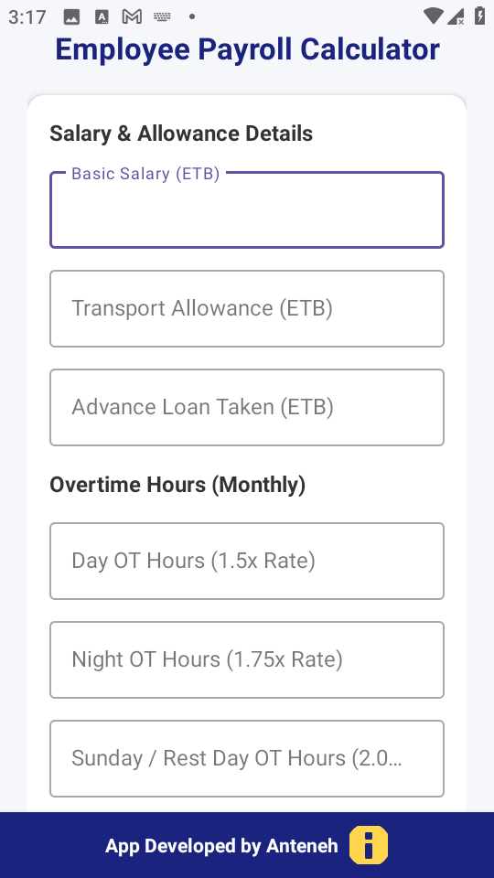
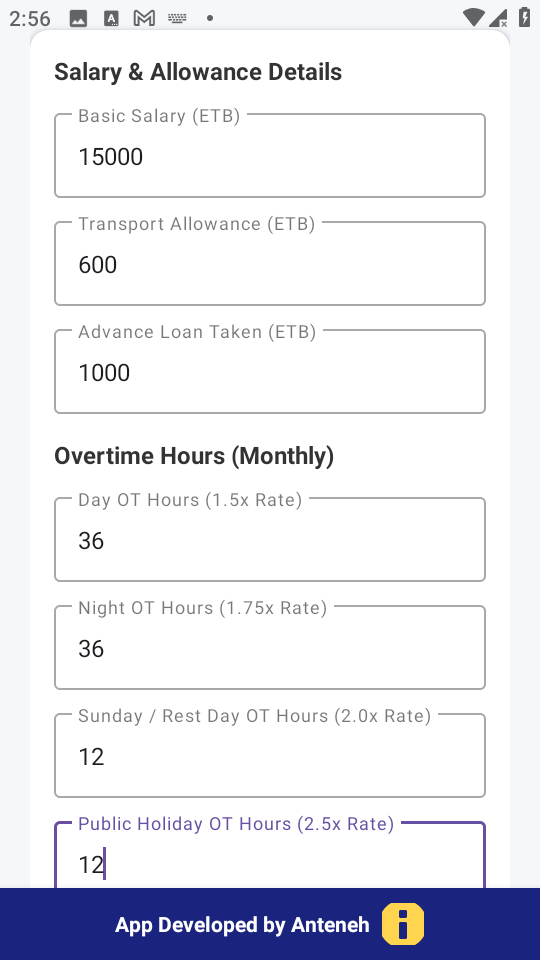
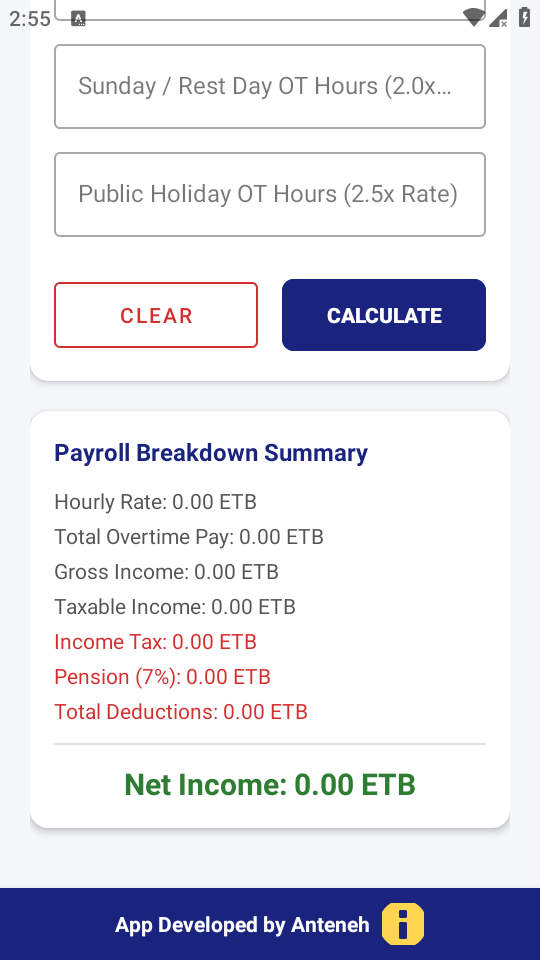
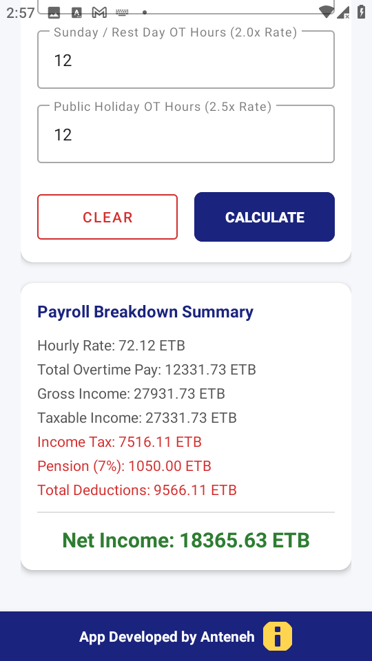

# 📱 Ethiopian Net Salary & Payroll Calculator

A robust, user-friendly native Android application engineered to calculate Ethiopian net salaries, income tax tiers, pension contributions, and overtime compensation accurately.

---

## 📸 App Preview

  
  &nbsp;
  
  &nbsp;
  
  &nbsp;
  

---

## 🛠️ Key Technical Highlights
* **Architecture & UI:** Built with clean native Android views, responsive layouts, and Material Design guidelines.
* **Business Logic:** Implements real-world tax bracket calculations, employee deductions (7% pension), and custom overtime multipliers.
* **Analytics:** Integrated with Firebase Analytics to monitor user engagement and app stability.

---

## 📥 Download & Test the App
You can download the pre-compiled build directly to test it on your Android device:
* 👉 **[Download app-release.apk (v1.0.0)](https://github.com/antiye20-del/SallaryCalculater-App/releases/download/v1.0.0/app-release.apk)**

---

## 📬 Connect & Contact Me
I am open to international remote job opportunities, technical collaborations, and mentorship connections! If you have feedback on the app or would like to discuss software engineering, feel free to reach out:

- 🐙 **GitHub Profile:** [antiye20-del](https://github.com/antiye20-del)
- 💼 **LinkedIn:** [Anteneh Meseret](https://www.linkedin.com/in/anteneh-meseret-869534134)
- ✈️ **Telegram:** [@antekiya](https://t.me/antekiya)
- ✉️ **Email:** [antiye20@gmail.com](mailto:antiye20@gmail.com)
- 📞 **Phone:** [+251 916 107 723](tel:+251916107723)
  
Feel free to open an **[Issue](../../issues)** or start a **[Discussion](../../discussions)** directly in this repository!
